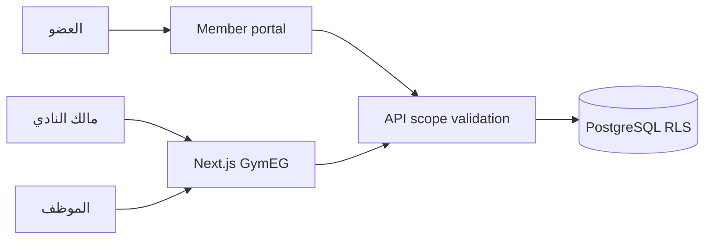
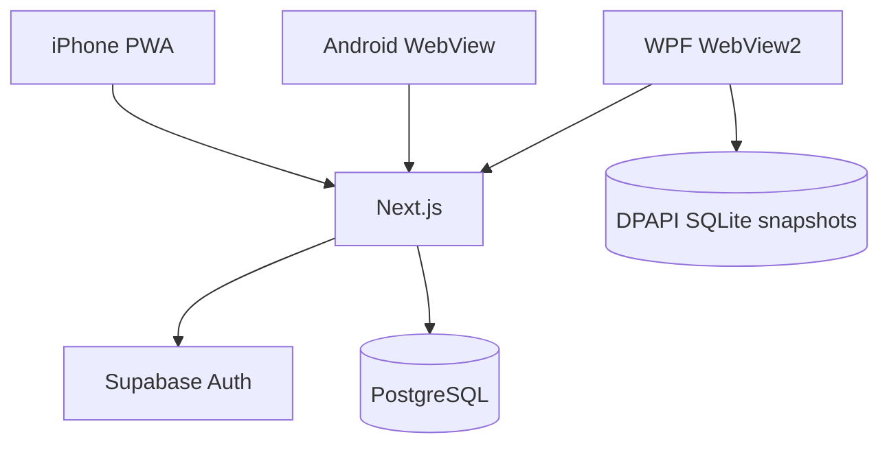
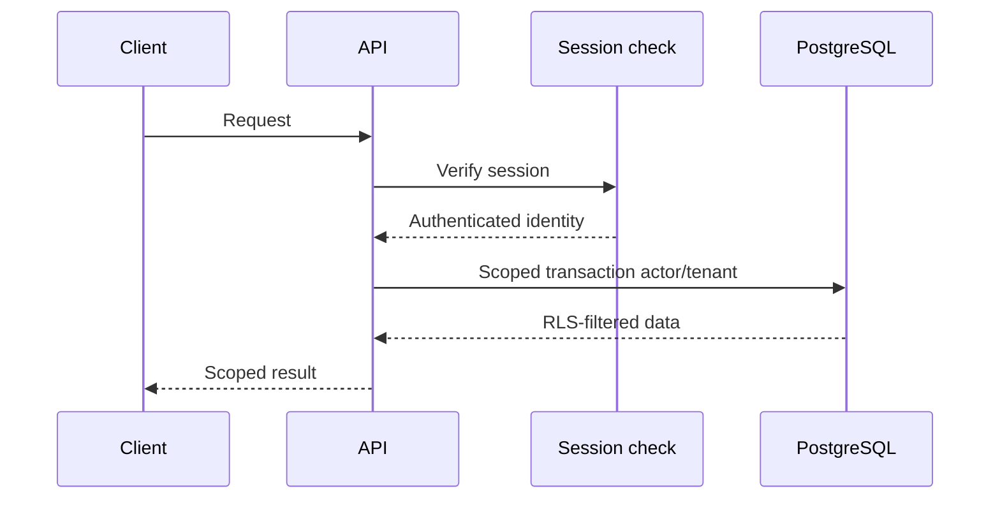
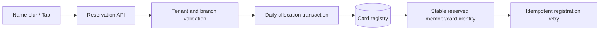
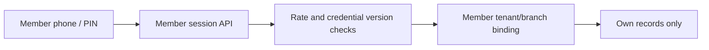
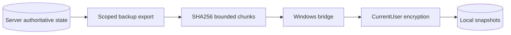
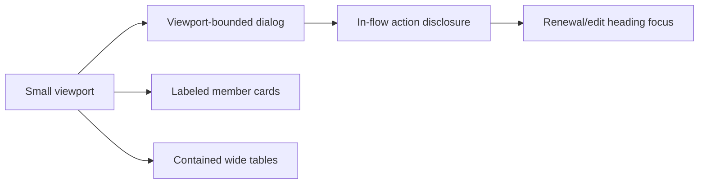
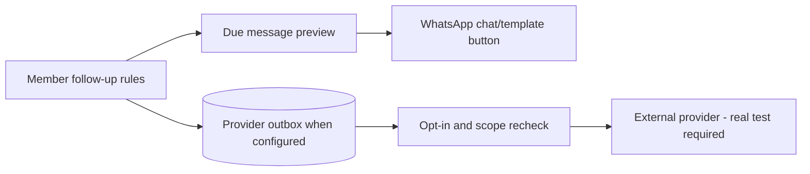
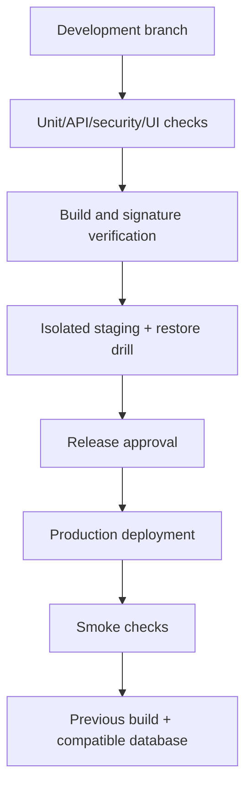

# مخططات GymEG — من المصدر والكتالوج

توصيف حدود المكونات لا يمثل شهادة اختبار تكامل خارجي.

## 1. سياق النظام

## 2. الحاويات

## 3. طلب محمي

## 4. حجز الباركود

## 5. الدخول

## 6. النسخ والاسترجاع

## 7. الموبايل

## 8. الرسائل

## 9. الطرح والرجوع

## 10. ERD — الأعمدة والـ Foreign Keys الفعلية

لا تُضاف علاقات غير معرفة كـ FK في الكتالوج؛ العلاقات داخل JSONB تتطلب نموذج مجال مستقل.

```mermaid
erDiagram
 member_code_access {
  text owner_id
  text member_id
  text branch
  text code_hash
  text code_cipher
  integer version
  boolean revoked
  boolean inactive
  text phone_hash
  text pin_hash
  text pin_cipher
  boolean pin_must_change
 }
 member_code_sessions {
  text session_hash
  text owner_id
  text member_id
  integer version
  timestamp_with_time_zone expires_at
 }
 member_code_attempts {
  text bucket
  timestamp_with_time_zone started_at
  integer attempts
 }
 membership_cards {
  text code
  text owner_id
  text member_id
  text branch
  text status
  jsonb payload
  timestamp_with_time_zone created_at
 }
 card_number_counters {
  text day
  integer value
 }
 gym_access {
  text owner_id
  text user_id
  text name
  text role
  text branches
  integer revoked
 }
 gym_states {
  text user_id
  text payload
  integer revision
  text updated_at
 }
 gym_recovery {
  text id
  text owner_id
  text payload
  text created_at
 }
 gym_invites {
  text token_hash
  text owner_id
  text role
  text branches
  text expires_at
  text claimed_by
 }
 gym_entities {
  text owner_id
  text collection
  text entity_id
  integer position
  text branch
  jsonb payload
 }
 gym_photos {
  text owner_id
  text member_id
  text content
 }
 gym_access_events {
  text id
  text owner_id
  text actor
  text target
  text action
  timestamp_with_time_zone at
  jsonb details
 }
 commercial_plans {
  text id
  text name
  text currency
  bigint monthly_minor
  bigint annual_minor
  bigint perpetual_minor
  bigint maintenance_minor
  jsonb limits
  boolean published
  integer revision
 }
 tenants {
  text id
  text storage_key
  text name
  text created_by
  timestamp_with_time_zone created_at
 }
 tenant_memberships {
  text tenant_id
  text user_id
  text role
  jsonb branches
  text name
  boolean revoked
 }
 tenant_licenses {
  text tenant_id
  text plan_id
  text mode
  text status
  timestamp_with_time_zone starts_at
  timestamp_with_time_zone ends_at
  timestamp_with_time_zone maintenance_until
  jsonb limits
  integer revision
  timestamp_with_time_zone updated_at
 }
 activation_requests {
  text id
  text tenant_id
  text user_id
  text plan_id
  text mode
  text status
  jsonb entitlements
  bigint expected_minor
  text currency
  text transfer_ref
  date transfer_day
  bigint paid_minor
  text note
  text review_note
  timestamp_with_time_zone created_at
  timestamp_with_time_zone reviewed_at
  text reviewed_by
 }
 trial_claims {
  text owner_id
  text tenant_id
  timestamp_with_time_zone starts_at
  timestamp_with_time_zone ends_at
 }
 platform_settings {
  integer id
  jsonb payload
  integer revision
 }
 gym_backup_transfers {
  uuid id
  text owner_id
  text actor_id
  text mode
  integer bytes
  text digest
  jsonb chunks
  timestamp_with_time_zone expires_at
 }
 platform_admins {
  text user_id
  timestamp_with_time_zone created_at
 }
 commercial_audit {
  text id
  text actor
  text tenant_id
  text action
  jsonb details
  timestamp_with_time_zone at
 }
 gym_activity_archive {
  text owner_id
  text event_id
  text branch
  text at
  jsonb payload
 }
 whatsapp_connections {
  text owner_id
  text branch
  text phone_id
  text token_cipher
  text api_version
  timestamp_with_time_zone updated_at
  timestamp_with_time_zone last_run_at
 }
 member_portal_access {
  text owner_id
  text member_id
  text branch
  text user_id
  text email
  text invite_hash
  timestamp_with_time_zone expires_at
  boolean revoked
 }
 member_faces {
  text owner_id
  text member_id
  text branch
  text model
  jsonb embedding
  timestamp_with_time_zone consented_at
 }
 whatsapp_rules {
  text owner_id
  text id
  text branch
  jsonb payload
 }
 whatsapp_outbox {
  text owner_id
  text id
  text branch
  text member_id
  text rule_id
  text occurrence
  text status
  jsonb payload
  text provider_id
  text error
  timestamp_with_time_zone updated_at
 }
 gym_states ||--o{ member_code_access : FK
 member_code_access ||--o{ member_code_sessions : FK
 tenants ||--o{ tenant_memberships : FK
 commercial_plans ||--o{ tenant_licenses : FK
 tenants ||--o{ tenant_licenses : FK
 commercial_plans ||--o{ activation_requests : FK
 tenants ||--o{ activation_requests : FK
 tenants ||--o{ trial_claims : FK
 gym_states ||--o{ whatsapp_connections : FK
 gym_states ||--o{ member_portal_access : FK
 gym_states ||--o{ member_faces : FK
 gym_states ||--o{ whatsapp_rules : FK
 gym_states ||--o{ whatsapp_outbox : FK
```

